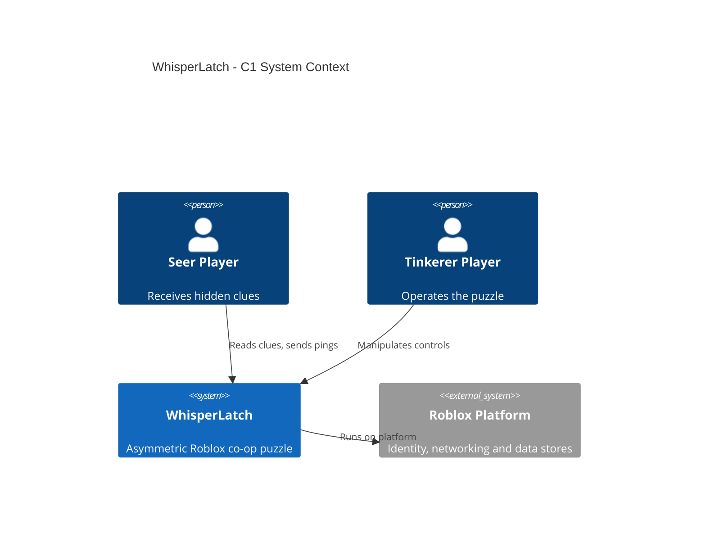
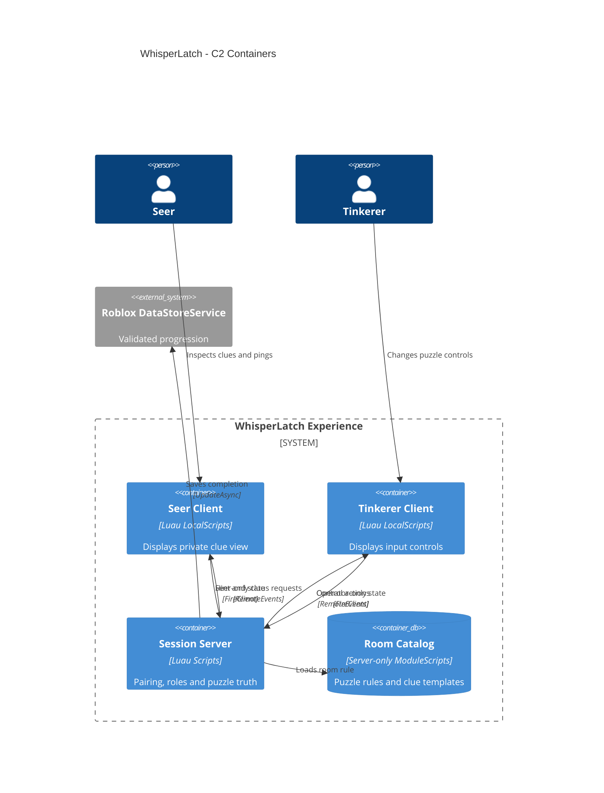
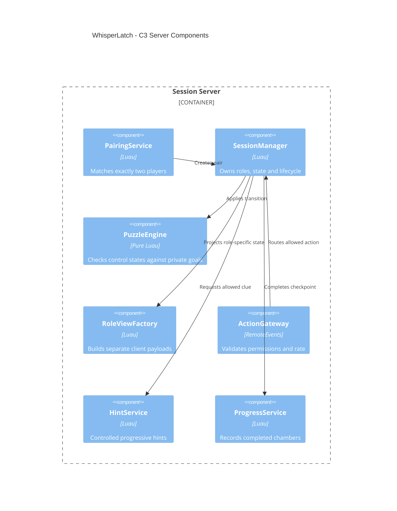
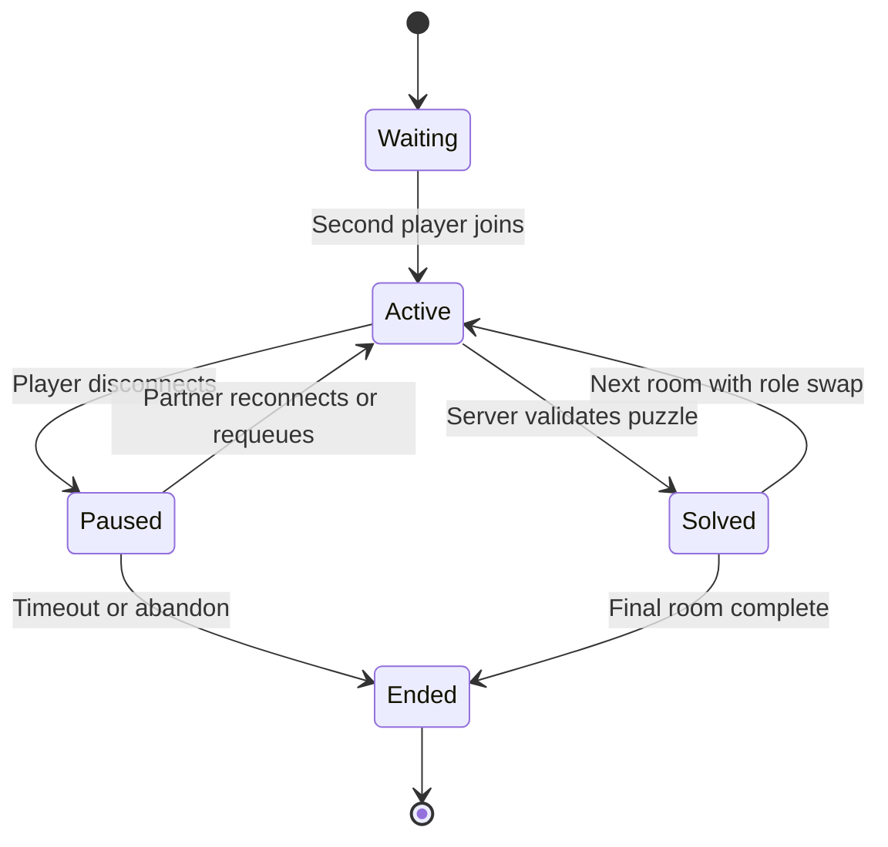

# WhisperLatch

> **Two players. Two rooms. One shared solution.** One player knows the clue, the other controls the lock.

**Project:** Roblox asymmetric co-op escape game / single repository  
**Status:** Pre-production specification — README only; no runnable game is included.  
**Working title:** `WhisperLatch` (preliminary web name screening only; **not** legally trademark-cleared).  
**Inspiration:** Asymmetric cooperative information puzzles as a broad genre (for example *We Were Here*); **no** copied puzzles, rooms, art, symbols, scripts, dialogue or branding.

## 1. Game concept

- **Players:** Exactly 2 per puzzle session for MVP; up to 6 independent pairs per Roblox server subject to performance.
- **Platform:** Roblox mobile and desktop first; accessible controls, optional gamepad.
- **Format:** Short connected rooms, each played as a separate cooperative puzzle.
- **Session target:** 10–15 minutes for a 5-room run, with checkpoints.
- **Unique angle:** Strong communication puzzles using **asymmetric information**, not frantic platforming or voice-chat dependency.

### Roles and gameplay loop

| Role | Can see | Can do |
|---|---|---|
| **Seer** | Clue cards, hidden rules, patterns or ordering hints | Select/predefine clue pings; inspect clue panels |
| **Tinkerer** | Puzzle controls, buttons, dials, physical room | Manipulate locks, switches and devices |

1. Two players join the same lobby and are assigned different roles.
2. The server creates a **randomized, verifiably solvable** puzzle instance.
3. The Seer receives the solution clue **only on the Seer's client**.
4. The Tinkerer sees the controls **without** the hidden solution.
5. Players communicate through predefined symbol pings and Roblox's default moderated chat when available (never require voice chat).
6. The server verifies the input, unlocks the exit, and advances both players to a checkpoint.
7. Roles alternate after each completed room so both players experience both sides.

### Concrete MVP puzzles

| Room | Seer observes | Tinkerer operates | Validation |
|---|---|---|---|
| 1. Glyph Gate | A 3-symbol ordered sequence | 3 rotating glyph dials | Correct sequence |
| 2. Circuit Split | A small wiring rule diagram | 4 on/off switches | Boolean rule matches |
| 3. Mirror Clocks | A relative-order clue | 3 clock hands | Correct positions |
| 4. Pattern Relay | A shape transformation rule | Colored tile grid | Exact resulting pattern |
| 5. Dual Reactor | A short sequence with two stages | Buttons and one timing gate | Two-stage state machine |

**MVP rule:** Prefer deterministic interactions and small finite puzzle states. Avoid physics-heavy movable objects, timed death traps, and arbitrary hidden objectives. Each room must have a restart option and a finite hint progression.

### Communication without voice dependency

- Built-in **symbol wheel**: send one of a small fixed set of glyph/icon messages; no user-entered free-form text in custom systems.
- Predefined status pings: “Look at clue”, “Try next”, “Repeat”, “Ready”, “Need hint”.
- Optional use of Roblox's existing moderated text chat according to player settings and current platform policy; no custom unfiltered chat relay.
- Color clues also carry shape/name labels for accessibility.
- On partner disconnect: freeze the chamber, keep a temporary checkpoint, offer to requeue or leave. Implement reconnection handling; **never** permanently trap the remaining player.

## 2. MVP / non-goals

### MVP deliverables

- [ ] Simple lobby pairing and session creation for two players on the **same server**.
- [ ] Secure role assignment, role switching and session state machine.
- [ ] Two spatially separated chambers and 5 distinct, data-defined puzzle rooms.
- [ ] Server-only solution and role-restricted clue distribution via `FireClient`.
- [ ] Touch-friendly controls, symbol wheel, preset status pings and hint requests.
- [ ] Per-room reset, checkpoints, disconnect and timeout handling.
- [ ] Progress tracking: rooms cleared, hint usage and completion time per pair.
- [ ] Tests for role isolation, server authorization, puzzle correctness, and multiplayer joins/leaves.

### Out of scope until validation

3–4 player teams, global parties spanning different servers, paid hints, voice-based progression, heavy cinematic storytelling, matchmaking ranking, in-game user-authored chat, UGC puzzles and external communication services.

## 3. Data model and trust boundaries

**Critical invariant:** The Tinkerer must never receive the solution as replicated data. Keep the secret in `ServerScriptService` / server memory. Do not publish the solution in a shared `Workspace` instance, `ReplicatedStorage` ModuleScript, replicated Value objects, or RemoteEvent broadcast.

```luau
--!strict
export type SessionStatus = "waiting" | "active" | "solved" | "paused" | "ended"
export type Role = "Seer" | "Tinkerer"
export type Session = {
    id: string,
    playerIds: { number },
    roleByUserId: { [number]: Role },
    roomIndex: number,
    status: SessionStatus,
    revision: number,
    -- Puzzle solution lives in the server-owned Session internals.
}
```

Client request contract:

```text
ActionRequest = { sessionId, roomId, actionType, controlId, actionValue, expectedRevision }
StatusPing    = { sessionId, enumPingId }
HintRequest   = { sessionId, roomId }
```

Only the **server** may compare an input to the hidden solution. It checks session membership, role, room, action type, control IDs/values, phase, cooldown and revision. Send back role-specific view models (`SeerView` or `TinkererView`). Distribute clues using targeted `RemoteEvent:FireClient(player, ...)` calls. The client is an untrusted view and input device.

**Room 1 example:** The server samples 3 symbols from a fixed approved vocabulary and stores `[sun, arch, leaf]`. It sends that ordered clue to Seer only. The Tinkerer sees a 3-dial interface without the target order. Both players can exchange predefined symbol pings. Server checks whether the 3 dials match the target and then advances the session atomically. This does not promise secrecy against out-of-band communication, which is part of co-op play.

## 4. C4 architecture

### C1 — System context



### C2 — Containers (logical execution boundaries)



### C3 — Session server components



One Roblox experience hosts all components. A separate database or cloud backend is **not** required. Reserved-server teleports and cross-server matchmaking are deliberately excluded from the MVP.

## 5. State machine



A `revision` guards against concurrent/stale control changes. Transition logic is deterministic, has no yielding calls in critical mutation sections, and issues role-specific updates **after** committing server state. Add idempotency for duplicate requests. A `SessionManager` owns player membership so a user cannot simultaneously control two sessions.

## 6. Repository structure (target)

```text
whisperlatch/
├── README.md
├── AGENTS.md
├── rokit.toml
├── default.project.json
├── selene.toml
├── .stylua.toml
├── .luaurc
├── src/
│   ├── shared/              # protocol types, safe ping enums, UI models
│   ├── client/              # role UI, control input, pings, chamber view
│   └── server/
│       ├── logic/           # pure PuzzleEngine and room rule validation
│       ├── rooms/           # server-only clue templates and goal rules
│       └── services/        # Pairing, Sessions, RoleView, Hints, Progress
├── tests/                   # roles, security, join/leave, five rooms
├── scripts/                 # Lune test runner
└── .gitlab-ci.yml
```

## 7. Tools and setup

**Verified stable tool baseline (2026-10-15).** Roblox Studio is updated continuously; use pinned external versions because there is no conventional Roblox Studio LTS channel.

| Tool | Version / approach | Purpose |
|---|---|---|
| Roblox Studio | Current stable | 3D chambers, simulator, live test |
| Luau | `--!strict` in Studio | Typed server and client code |
| VS Code + Codex CLI | Current supported release | AI-assisted coding |
| Studio MCP | Built in | Codex examines/edits scene and runs tests |
| Rokit | 1.2.0 | Toolchain management |
| Rojo | 7.7.1 | Source filesystem ↔ Studio sync |
| Lune | 0.11.0 | Pure-luau unit tests and contract tests |
| Selene | 0.32.0 | Lint |
| StyLua | 2.6.0 | Formatting |
| Wally | 0.3.2, optional | Optional packages after license/security review |
| Git / GitLab CI | Existing | Source control and CI |
| Studio Server & Clients | Built in | Actual two-client simulation |
| StudioTestService | Built in, optional | Programmatic multi-client plugin tests |

**Bootstrap an empty repository:**

1. Install Roblox Studio, Git, Codex CLI, and Rokit from official sources.
2. Add pinned tools:

```powershell
rokit init
rokit add rojo-rbx/rojo@7.7.1
rokit add lune-org/lune@0.11.0
rokit add Kampfkarren/selene@0.32.0
rokit add JohnnyMorganz/StyLua@2.6.0
# optional: rokit add UpliftGames/wally@0.3.2
rokit install
rojo init
rojo plugin install
```

3. Map `src/shared` → `ReplicatedStorage`, `src/server` → `ServerScriptService`, `src/client` → `StarterPlayerScripts`. Never map `src/server/rooms` into replicated containers.
4. Add configs (`--!strict`, Selene, StyLua), test runner and CI; start `rojo serve` and connect Studio to the Rojo plugin.
5. Enable **Assistant → MCP Servers → Studio as MCP Server → Quick Connect: Codex CLI**.
6. In Studio run **Server & Clients** using two clients, not just a single local Play session.
7. Once Codex generates the missing files, enforce:

```powershell
stylua --check src tests
selene src tests
lune run scripts/test.luau
rojo build default.project.json --output build/whisperlatch.rbxlx
```

This starter delivers only documentation. The source and test files referred to above are deliverables, **not currently included**.

## 8. Security, accessibility, reliability

- **Server-only secrets:** Keep solutions in server memory/ServerScriptService; clients receive least-privilege view models. Assume users can inspect everything sent to their own client.
- **Role validation:** Only Tinkerer may manipulate controls; Seer may request designated hints and status pings. Server checks proximity/room where relevant.
- **No unrestricted custom chat:** Preset ping IDs only. Use Roblox's existing moderated chat features if appropriate to player account and policy. Voice is never required.
- **Latency:** User interaction optimistically animates only cosmetic effects; the server confirms authoritative puzzle state.
- **Disconnections:** Freeze, checkpoint, requeue/reconnect, and cleanup TTL; don't let late events from abandoned sessions mutate a new session.
- **Accessibility:** Glyph shape labels in addition to color, scalable typography, comfortable tap targets, no sound-only clue.
- **Persistence:** Server-signed achievement state via guarded `DataStoreService:UpdateAsync`; no client-submitted rewards.
- **Player safety:** Keep rooms non-graphic, avoid manipulative monetization and avoid forcing contact with other players outside normal Roblox safety tools.
- **Performance:** Reuse small chamber assets, separate per-session instances or zones, and limit replicated parts.

## 9. Test plan / definition of done

- [ ] Two users can pair and receive different roles. A third user cannot join their session.
- [ ] Clue payload is **never** delivered to Tinkerer, including on join, reconnect and role swap.
- [ ] Every room has at least one confirmed solution and valid server verification.
- [ ] Wrong order, malformed args, spoofed role, stale revision and rapid-fire interactions are rejected.
- [ ] Role swaps take effect exactly once per room.
- [ ] Disconnect/reconnect, timeout, requeue and overlapping lobby requests do not orphan sessions.
- [ ] All puzzles can be completed with **preset symbol/status pings only**, without voice chat.
- [ ] 2-client testing verifies independent UI and server consistency under latency.
- [ ] Keyboard, mouse and phone controls are functional and text is legible.
- [ ] Lint, formatting, Lune unit tests and Rojo build pass in CI.

## 10. Codex implementation sequence

1. Scaffold pinned Rojo / Lune / strict Luau project and GitLab CI; add `AGENTS.md`.
2. Implement `PuzzleEngine` for **Room 1 — Glyph Gate** as a pure module with tests.
3. Implement server `PairingService`, `SessionManager`, role model and revisioned action protocol.
4. Implement `RoleViewFactory` and test secret-leakage prevention.
5. Build a tiny two-room scene with distinct Seer/Tinkerer UI; test two clients through Studio MCP and Server & Clients.
6. Add preset symbol pings, reliable role switching, disconnect/rejoin, hints and room checkpoint.
7. Implement four additional distinct puzzles and automate relevant multiplayer tests.
8. Test mobile UI, accessibility, performance, and analytics before public beta.

**Codex starter instruction:** “Read README.md carefully. Implement Phase 1 only: the strict-Luau server-authoritative Session/Puzzle model for Glyph Gate and unit tests. Provide separate SeerView and TinkererView constructors, and tests ensuring solution secrecy and role checks. Do not implement custom text chat, cross-server matchmaking, monetization or voice dependencies.”

## 11. IP and release notes

- `WhisperLatch` is a working title only. An initial public web search on 2026-10-15 found no identical indexed matches, but **no authoritative trademark clearance** has been completed.
- Check exact and similar names in Austrian see.ip, EUIPO/TMview, international databases, Roblox game search and commercial storefronts before publication.
- Build all puzzles, artwork, room layouts, symbols and branding independently. The source title *We Were Here* is a **mechanical inspiration**, not a name/asset license.
- Decide on code and asset licensing explicitly before making the repository public.

### Reference documentation

- Studio MCP and Codex integration: https://create.roblox.com/docs/studio/mcp
- Roblox external tools: https://create.roblox.com/docs/projects/external-tools
- Roblox security boundary: https://create.roblox.com/docs/scripting/security/client-server-boundary
- Roblox RemoteEvents: https://create.roblox.com/docs/scripting/events/remote
- Roblox Studio multiplayer testing: https://create.roblox.com/docs/studio/testing-modes
- StudioTestService: https://create.roblox.com/docs/reference/engine/classes/StudioTestService
- Data stores: https://create.roblox.com/docs/cloud-services/data-stores
- C4 syntax: https://mermaid.js.org/syntax/c4.html
- Trademark registry Austria: https://seeip.patentamt.at/markesuche
- EUIPO / TMview: https://www.euipo.europa.eu/en/search-ip
