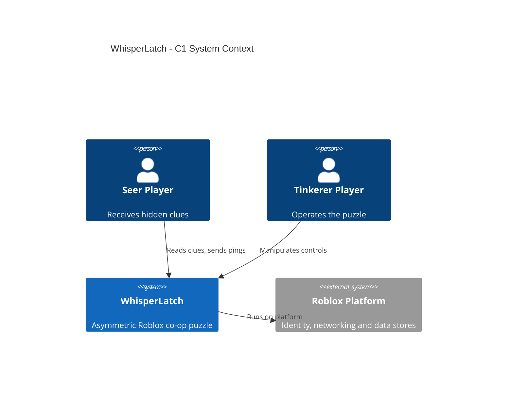
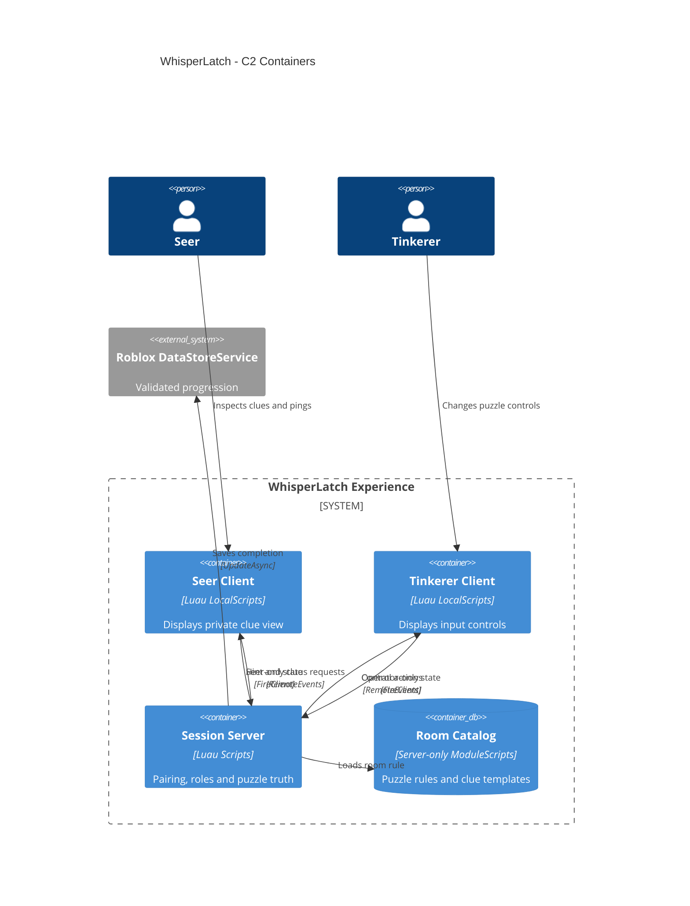
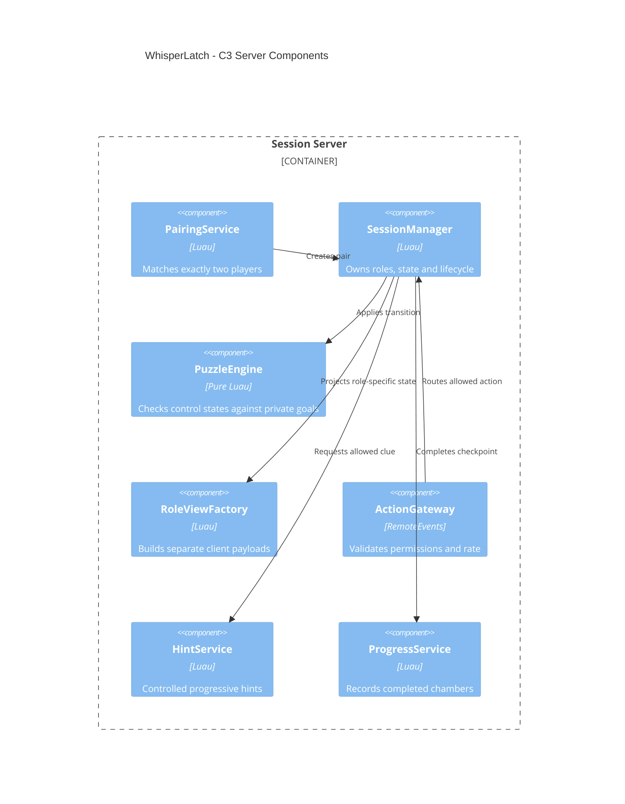
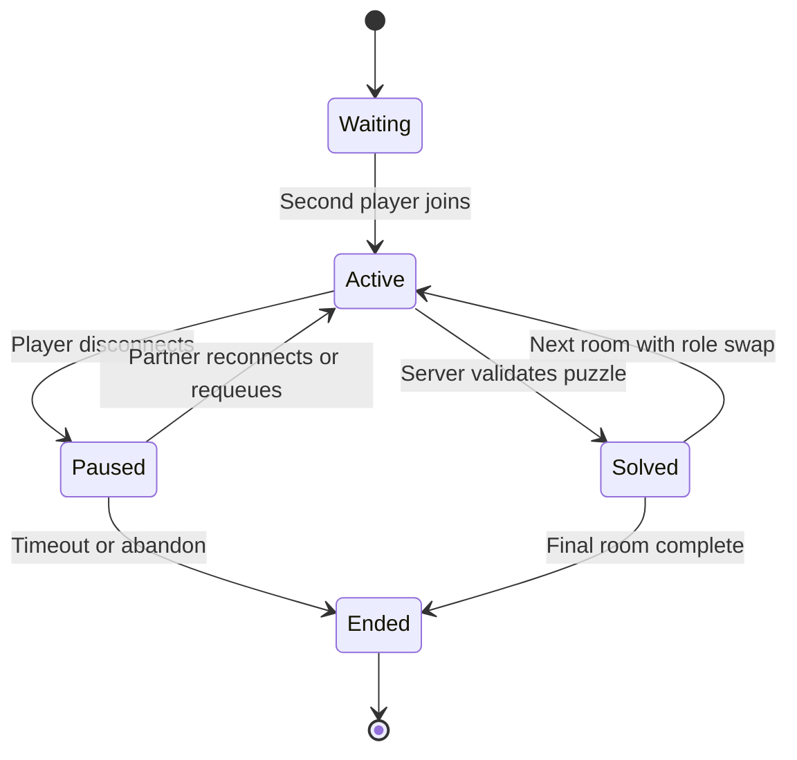

# WhisperLatch

> **Two players. Two rooms. One shared solution.** One player knows the clue, the other controls the lock.

**Project:** Roblox asymmetric co-op escape game / single repository  
**Status:** MVP v0.1 — playable source for 2 players and 5 rooms. Verified by automated tests, a Roblox smoke test and a Rojo build outside Studio; the first live Studio playtest with two clients is still pending.  
**Working title:** `WhisperLatch` (preliminary web name screening only; **not** legally trademark-cleared).  
**Inspiration:** Asymmetric cooperative information puzzles as a broad genre (for example *We Were Here*); **no** copied puzzles, rooms, art, symbols, scripts, dialogue or branding.

## 0. Quick start (MVP)

1. Install [Rokit](https://github.com/rojo-rbx/rokit), then run `rokit install` in the repository (installs the pinned Rojo, Lune, Selene and StyLua from `rokit.toml`).
2. Build a place file and open it in Roblox Studio:
   `rojo build default.project.json --output build/whisperlatch.rbxlx`
   For live development use `rojo serve` and connect the Rojo Studio plugin instead.
3. In Studio choose **Test → Clients and Servers** with **2 players**. Both players press **„Partner suchen“** in the lobby.
4. The server pairs them, assigns roles and teleports each player into their **own** enclosed chamber. Each player only sees their own room and role UI.
5. Optional: *Game Settings → Security → Enable Studio Access to API Services* to save progress (the game runs without it), and *Max Players* 12 for 6 parallel pairs.

| Input | Desktop | Mobile |
|---|---|---|
| Move | WASD + mouse | Thumbstick |
| Interact (clue wall, symbol table, console, check pedestal) | `E` at the prompt | Tap the prompt |
| Read the clue / operate controls | Role panel on the right of the HUD; mirrored on the chamber wall | Tap |
| Communicate | Ping wheel on the left (status, symbols, numbers, rules) or Roblox chat | Tap |
| Hint / reset room / leave | Buttons top left | Tap |

## 1. Game concept

- **Players:** Exactly 2 per puzzle session for MVP; up to 6 independent pairs per Roblox server subject to performance.
- **Platform:** Roblox mobile and desktop first; accessible controls, optional gamepad.
- **Format:** Short connected rooms, each played as a separate cooperative puzzle.
- **Session target:** 10–15 minutes for a 5-room run, with checkpoints.
- **Unique angle:** Strong communication puzzles using **asymmetric information**, not frantic platforming or voice-chat dependency.

### Roles and gameplay loop

| Role | Can see | Can do |
|---|---|---|
| **Seer** | Clue cards, hidden rules, patterns or ordering hints | Select/predefine clue pings; inspect clue panels |
| **Tinkerer** | Puzzle controls, buttons, dials, physical room | Manipulate locks, switches and devices |

1. Two players join the same lobby and are assigned different roles.
2. The server creates a **randomized, verifiably solvable** puzzle instance.
3. The Seer receives the solution clue **only on the Seer's client**.
4. The Tinkerer sees the controls **without** the hidden solution.
5. Players communicate through predefined symbol pings and Roblox's default moderated chat when available (never require voice chat).
6. The server verifies the input, unlocks the exit, and advances both players to a checkpoint.
7. Roles alternate after each completed room so both players experience both sides.

### Concrete MVP puzzles

| Room | Seer observes | Tinkerer operates | Validation |
|---|---|---|---|
| 1. Glyph Gate (*Glyphentor*) | A 3-symbol ordered sequence | 3 rotating glyph dials | Correct sequence |
| 2. Circuit Split (*Schaltkreis*) | A small rule diagram: one anchor („▲ ist AN“) plus same/opposite relations that allow exactly one combination | 4 glyph-labelled on/off switches | Boolean rule matches |
| 3. Mirror Clocks (*Spiegeluhren*) | The three clocks as seen in a mirror: order reversed, hands mirrored | 3 clock hands (hour dials) | Correct real positions |
| 4. Pattern Relay (*Musterfeld*) | A shape transformation rule (rotate/mirror, optionally swap ☀/☾) | 3×3 tile grid; only the Tinkerer sees the reference pattern | Exact resulting pattern |
| 5. Dual Reactor (*Doppelreaktor*) | Ignition sequence plus a table „core → stabilisation sequence“ | 4 glyph buttons and a gate lever; after stage 1 only the Tinkerer sees the core symbol | Two-stage state machine |

All puzzles are generated per session from a seeded PRNG and are verified solvable by tests. The Dual Reactor's "timing gate" is a lever without time pressure (see MVP rule below).

**MVP rule:** Prefer deterministic interactions and small finite puzzle states. Avoid physics-heavy movable objects, timed death traps, and arbitrary hidden objectives. Each room must have a restart option and a finite hint progression.

### Communication without voice dependency

- Built-in **symbol wheel**: send one of a small fixed set of glyph/icon messages; no user-entered free-form text in custom systems.
- Predefined status pings: “Look at clue”, “Try next”, “Repeat”, “Ready”, “Need hint”.
- Optional use of Roblox's existing moderated text chat according to player settings and current platform policy; no custom unfiltered chat relay.
- Color clues also carry shape/name labels for accessibility.
- On partner disconnect: freeze the chamber, keep a temporary checkpoint, offer to requeue or leave. Implement reconnection handling; **never** permanently trap the remaining player.

### Visual design (derived from the concept art)

The two concept images (`ChatGPT-Bild …png`) show **both players side by side** for illustration only. In the game each player is teleported into their own fully enclosed chamber and sees only their own room and role HUD: chamber pairs are 200 studs apart, rooms are closed boxes, camera zoom is capped at 22 studs.

- **Seer chamber:** warm amber candle light, wood and brick, the *Hinweiswand* (clue wall) with the secret clue, a symbol table with the glyph legend, bookshelves, notes, rug.
- **Tinkerer chamber:** cyan neon, metal and copper pipes, the *Steuerwand* with the controls, a console, the check pedestal („Lösung prüfen“) and a switch box.
- **Shared wall:** a chained, locked exit door (*Ausgang*). It opens when the room is solved — the only moment the players see each other — then roles swap and the next room starts.
- **HUD:** role card top right („Deine Rolle: Seher/Tüftler“), room title and timer top centre, the role panel on the right, hints and the ping wheel on the left. Dark panels, amber accents for the Seer, cyan for the Tinkerer, serif titles. Scales down for phones.
- **Local-only panels:** the clue and control panels on the chamber walls are rendered by each client (`SurfaceGui` in `PlayerGui`). The replicated world never contains puzzle data.
- **Glyphs:** ☾ Mond, ✦ Stern, ☀ Sonne, ◎ Ring, ▲ Dreieck, ◆ Raute — always symbol, name and color together.

## 2. MVP / non-goals

### MVP deliverables

- [x] Simple lobby pairing and session creation for two players on the **same server** (`PairingService`, FIFO).
- [x] Secure role assignment, role switching and session state machine (`SessionManager`).
- [x] Two spatially separated chambers and 5 distinct, data-defined puzzle rooms (`ChamberService`, `src/server/rooms`).
- [x] Server-only solution and role-restricted clue distribution via `FireClient` (`RoleViewFactory`).
- [x] Touch-friendly controls, symbol wheel, preset status pings and hint requests (`src/client/ui`).
- [x] Per-room reset, checkpoints, disconnect and timeout handling (reconnect works when the player rejoins the same server).
- [x] Progress tracking: rooms cleared, hint usage and completion time (`ProgressService`, guarded `UpdateAsync`).
- [x] Tests for role isolation, server authorization, puzzle correctness, and multiplayer joins/leaves (`tests/`, simulated clients).

### Out of scope until validation

3–4 player teams, global parties spanning different servers, paid hints, voice-based progression, heavy cinematic storytelling, matchmaking ranking, in-game user-authored chat, UGC puzzles and external communication services.

## 3. Data model and trust boundaries

**Critical invariant:** The Tinkerer must never receive the solution as replicated data. Keep the secret in `ServerScriptService` / server memory. Do not publish the solution in a shared `Workspace` instance, `ReplicatedStorage` ModuleScript, replicated Value objects, or RemoteEvent broadcast.

```luau
--!strict
export type SessionStatus = "waiting" | "active" | "solved" | "paused" | "ended"
export type Role = "Seer" | "Tinkerer"
export type Session = {
    id: string,
    playerIds: { number },
    roleByUserId: { [number]: Role },
    roomIndex: number,
    status: SessionStatus,
    revision: number,
    -- Puzzle solution lives in the server-owned Session internals.
}
```

Client request contract:

```text
ActionRequest = { sessionId, roomId, actionType, controlId, actionValue, expectedRevision }
StatusPing    = { sessionId, enumPingId }
HintRequest   = { sessionId, roomId }
```

Implemented `actionType` values: `stepDial`, `setDial`, `toggle`, `press`, `clearInput`, `submit` (Tinkerer only) and `reset` (either role). Lobby requests: `hello`, `queue`, `cancel`, `leave`, `requeue`.

Only the **server** may compare an input to the hidden solution. It checks session membership, role, room, action type, control IDs/values, phase, cooldown and revision. Send back role-specific view models (`SeerView` or `TinkererView`). Distribute clues using targeted `RemoteEvent:FireClient(player, ...)` calls. The client is an untrusted view and input device.

**Room 1 example:** The server samples 3 symbols from a fixed approved vocabulary and stores `[sun, arch, leaf]`. It sends that ordered clue to Seer only. The Tinkerer sees a 3-dial interface without the target order. Both players can exchange predefined symbol pings. Server checks whether the 3 dials match the target and then advances the session atomically. This does not promise secrecy against out-of-band communication, which is part of co-op play.

## 4. C4 architecture

### C1 — System context



### C2 — Containers (logical execution boundaries)



### C3 — Session server components



One Roblox experience hosts all components. A separate database or cloud backend is **not** required. Reserved-server teleports and cross-server matchmaking are deliberately excluded from the MVP.

## 5. State machine



A `revision` guards against concurrent/stale control changes. Transition logic is deterministic, has no yielding calls in critical mutation sections, and issues role-specific updates **after** committing server state. Add idempotency for duplicate requests. A `SessionManager` owns player membership so a user cannot simultaneously control two sessions.

## 6. Repository structure

```text
whisperlatch/
├── README.md
├── AGENTS.md                    # rules for coding agents
├── rokit.toml                   # pinned toolchain
├── default.project.json         # Rojo tree (+ RemoteEvents)
├── selene.toml / .stylua.toml / .luaurc
├── src/
│   ├── shared/                  # ReplicatedStorage.Shared
│   │   ├── Types.luau           # protocol + view models
│   │   ├── Protocol.luau        # remote names, action enums, limits
│   │   ├── Glyphs.luau          # public glyph vocabulary
│   │   ├── Pings.luau           # preset pings
│   │   └── World.luau           # names of world instances
│   ├── server/                  # ServerScriptService.Server
│   │   ├── Main.server.luau     # wiring: remotes, players, world
│   │   ├── logic/               # Rng, PuzzleEngine, Controls, RateLimiter (pure)
│   │   ├── rooms/               # server-only room definitions (5 rooms)
│   │   └── services/            # Pairing, SessionManager, RoleViewFactory,
│   │                            # ActionGateway, Hint, Progress, ChamberService
│   └── client/                  # StarterPlayerScripts.Client
│       ├── Main.client.luau     # wiring: remotes -> UI
│       ├── Net.luau             # requests + sequential action queue
│       ├── ui/                  # Theme, Hud, CluePanel, ControlPanel, PingPanel, LobbyScreen
│       └── world/ChamberDecor   # local-only wall panels and prompts
├── tests/                       # Lune specs + Solver/Harness helpers
├── scripts/
│   ├── test.luau                # test runner
│   ├── smoke.luau               # Roblox smoke test (world + UI)
│   └── lib/FakeTree.luau        # Rojo-tree emulation for instance requires
└── .github/workflows/ci.yml     # GitHub Actions
```

## 7. Tools and setup

**Verified stable tool baseline (2026-10-15).** Roblox Studio is updated continuously; use pinned external versions because there is no conventional Roblox Studio LTS channel.

| Tool | Version / approach | Purpose |
|---|---|---|
| Roblox Studio | Current stable | 3D chambers, simulator, live test |
| Luau | `--!strict` in Studio | Typed server and client code |
| VS Code + Codex CLI | Current supported release | AI-assisted coding |
| Studio MCP | Built in | Codex examines/edits scene and runs tests |
| Rokit | 1.2.0 | Toolchain management |
| Rojo | 7.7.1 | Source filesystem ↔ Studio sync |
| Lune | 0.11.0 | Pure-luau unit tests and contract tests |
| Selene | 0.31.0 (latest on crates.io) | Lint |
| StyLua | 2.6.0 | Formatting |
| Wally | 0.3.2, optional | Optional packages after license/security review |
| Git / GitHub Actions | `.github/workflows/ci.yml` | Format, lint, tests, smoke test, place build |
| Studio Server & Clients | Built in | Actual two-client simulation |
| StudioTestService | Built in, optional | Programmatic multi-client plugin tests |

**Bootstrap an empty repository:**

1. Install Roblox Studio, Git, Codex CLI, and Rokit from official sources.
2. Add pinned tools:

```powershell
rokit init
rokit add rojo-rbx/rojo@7.7.1
rokit add lune-org/lune@0.11.0
rokit add Kampfkarren/selene@0.31.0
rokit add JohnnyMorganz/StyLua@2.6.0
# optional: rokit add UpliftGames/wally@0.3.2
rokit install
rojo init
rojo plugin install
```

3. Map `src/shared` → `ReplicatedStorage`, `src/server` → `ServerScriptService`, `src/client` → `StarterPlayerScripts` (done in `default.project.json`). Never map `src/server/rooms` into replicated containers.
4. Add configs (`--!strict`, Selene, StyLua), test runner and CI; start `rojo serve` and connect Studio to the Rojo plugin.
5. Enable **Assistant → MCP Servers → Studio as MCP Server → Quick Connect: Codex CLI**.
6. In Studio run **Server & Clients** using two clients, not just a single local Play session.
7. Before every commit (CI runs the same):

```powershell
stylua --check src tests scripts
selene src tests
lune run scripts/test.luau
lune run scripts/smoke.luau
rojo build default.project.json --output build/whisperlatch.rbxlx
```

**How testing works without Studio:** game code uses normal Roblox instance requires (`require(script.Parent.X)`). `scripts/lib/FakeTree.luau` mirrors the Rojo tree for Lune, so the pure server modules run unchanged. `scripts/test.luau` runs the specs in `tests/` (puzzle generation and solvability, secrecy/non-interference of the role views, authorization, revisions, role swap, disconnect/timeout, payload validation, progress merge). `scripts/smoke.luau` builds the world and renders every role UI with Lune's Roblox instances, which validates all property names and types against the Roblox API. Real networking, physics, rendering and input still need a Studio playtest.

## 8. Security, accessibility, reliability

- **Server-only secrets:** Keep solutions in server memory/ServerScriptService; clients receive least-privilege view models. Assume users can inspect everything sent to their own client.
- **Role validation:** Only Tinkerer may manipulate controls; Seer may request designated hints and status pings. Server checks proximity/room where relevant.
- **No unrestricted custom chat:** Preset ping IDs only. Use Roblox's existing moderated chat features if appropriate to player account and policy. Voice is never required.
- **Latency:** User interaction optimistically animates only cosmetic effects; the server confirms authoritative puzzle state.
- **Disconnections:** Freeze, checkpoint, requeue/reconnect, and cleanup TTL; don't let late events from abandoned sessions mutate a new session.
- **Accessibility:** Glyph shape labels in addition to color, scalable typography, comfortable tap targets, no sound-only clue.
- **Persistence:** Server-signed achievement state via guarded `DataStoreService:UpdateAsync`; no client-submitted rewards.
- **Player safety:** Keep rooms non-graphic, avoid manipulative monetization and avoid forcing contact with other players outside normal Roblox safety tools.
- **Performance:** Reuse small chamber assets, separate per-session instances or zones, and limit replicated parts.

## 9. Test plan / definition of done

- [x] Two users can pair and receive different roles. A third user cannot join their session. *(automated)*
- [x] Clue payload is **never** delivered to Tinkerer, including on join, reconnect and role swap. *(automated, incl. non-interference tests per room)*
- [x] Every room has at least one confirmed solution and valid server verification. *(automated, 300 seeds per room)*
- [x] Wrong order, malformed args, spoofed role, stale revision and rapid-fire interactions are rejected. *(automated)*
- [x] Role swaps take effect exactly once per room. *(automated)*
- [x] Disconnect/reconnect, timeout, requeue and overlapping lobby requests do not orphan sessions. *(automated on the SessionManager level)*
- [ ] All puzzles can be completed with **preset symbol/status pings only**, without voice chat. *(ping set covers symbols, numbers 1–12, AN/AUS, rules; needs playtest)*
- [ ] 2-client testing verifies independent UI and server consistency under latency. *(Studio playtest pending)*
- [ ] Keyboard, mouse and phone controls are functional and text is legible. *(Studio/device test pending)*
- [x] Lint, formatting, Lune unit tests and Rojo build pass in CI.

## 10. Implementation sequence

1. [x] Scaffold pinned Rojo / Lune / strict Luau project and CI (GitHub Actions); add `AGENTS.md`.
2. [x] Implement `PuzzleEngine` for **Room 1 — Glyph Gate** as a pure module with tests.
3. [x] Implement server `PairingService`, `SessionManager`, role model and revisioned action protocol.
4. [x] Implement `RoleViewFactory` and test secret-leakage prevention.
5. [x] Build the two-chamber scene with distinct Seer/Tinkerer UI. **Open:** test two clients through Studio MCP and Server & Clients.
6. [x] Add preset symbol pings, reliable role switching, disconnect/rejoin, hints and room checkpoint.
7. [x] Implement four additional distinct puzzles and automate relevant multiplayer tests (simulated clients).
8. [ ] Test mobile UI, accessibility, performance, and analytics before public beta.

**Next steps:** first Studio playtest (2 clients, then a phone), tune puzzle difficulty and texts, sounds and door/solve effects, art pass on the chambers, analytics.

**Agent instructions:** see `AGENTS.md` (invariants, commands, how to add a room).

## 11. IP and release notes

- `WhisperLatch` is a working title only. An initial public web search on 2026-10-15 found no identical indexed matches, but **no authoritative trademark clearance** has been completed.
- Check exact and similar names in Austrian see.ip, EUIPO/TMview, international databases, Roblox game search and commercial storefronts before publication.
- Build all puzzles, artwork, room layouts, symbols and branding independently. The source title *We Were Here* is a **mechanical inspiration**, not a name/asset license.
- Decide on code and asset licensing explicitly before making the repository public.

### Reference documentation

- Studio MCP and Codex integration: https://create.roblox.com/docs/studio/mcp
- Roblox external tools: https://create.roblox.com/docs/projects/external-tools
- Roblox security boundary: https://create.roblox.com/docs/scripting/security/client-server-boundary
- Roblox RemoteEvents: https://create.roblox.com/docs/scripting/events/remote
- Roblox Studio multiplayer testing: https://create.roblox.com/docs/studio/testing-modes
- StudioTestService: https://create.roblox.com/docs/reference/engine/classes/StudioTestService
- Data stores: https://create.roblox.com/docs/cloud-services/data-stores
- C4 syntax: https://mermaid.js.org/syntax/c4.html
- Trademark registry Austria: https://seeip.patentamt.at/markesuche
- EUIPO / TMview: https://www.euipo.europa.eu/en/search-ip
